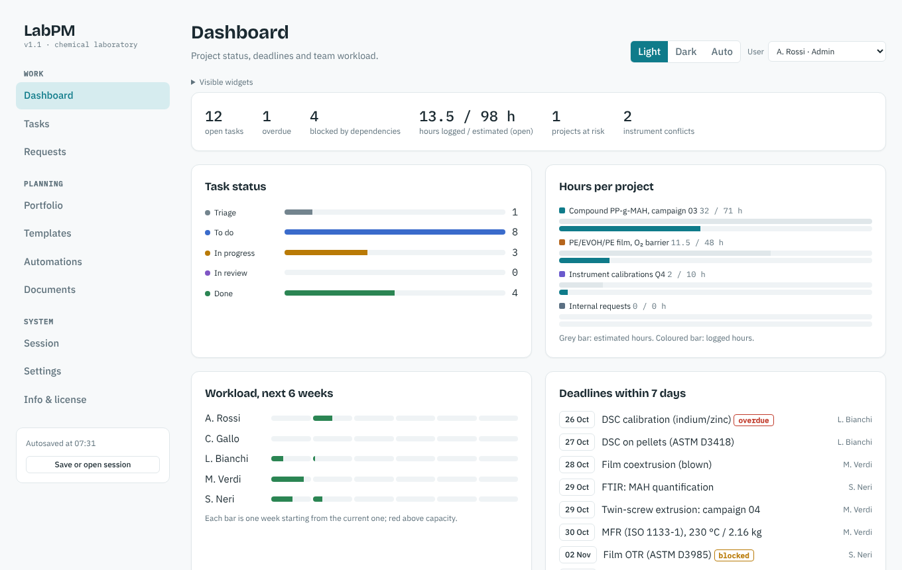

# LabPM

Project, task, resource and request manager for chemical / polymer laboratories. Single `index.html`, vanilla JavaScript, no backend, no build step.

Feature set modelled on dependent tasks, instrument conflicts, hours per person, intake requests, calibration/validation templates.

| | |
|---|---|
| Live demo | https://penfla.github.io/labpm/ (after enabling GitHub Pages, see [Deployment](#deployment)) |
| Repository | https://github.com/penfla/labpm |
| Version | 1.1.0 |
| Licence | [PolyForm Noncommercial 1.0.0](https://polyformproject.org/licenses/noncommercial/1.0.0) |
| Commercial use | penfla@me.com |



## Features

| Area | What it does |
|---|---|
| Dashboard | Configurable widgets: KPIs, task status, hours per project (estimated vs logged), 6-week workload vs capacity, deadlines ≤ 7 days, instrument conflicts, rule-based project summary |
| Tasks | 5 views on the same data: List (optional grouping), Board (drag & drop), Timeline (Gantt with dependency arrows, today line), Calendar (due dates), Workload (h/week/person) |
| Dependencies | Finish-to-start. A blocked task cannot move to *In progress / In review / Done*. Moving a due date shifts successors on working days (cascade) |
| Time tracking | Per-task timer (one running timer per user) and manual hour entries; logged vs estimated hours |
| Requests | Intake form → project *Internal requests*, status *Triage*; PM assigns and accepts |
| Automations | Trigger (status becomes… / task created / task overdue) + optional condition (project, priority, tag) + action (notify, assign, set priority, set status, add tag, create task); max chain depth 3 |
| Templates | DSC characterization (ASTM D3418 / ISO 11357-3), compound extrusion campaign, PE/EVOH/PE film (ASTM D3985, ISO 527-3), instrument calibration, analytical method validation |
| Custom fields | text, number, select, date, checkbox, formula (`{est}/{No. of samples}`; safe arithmetic parser, no `eval`) |
| Portfolio | Project health (auto: *At risk* if any task overdue), weighted progress, goals linked to projects |
| Documents | Markdown-lite notes linked to projects / tasks |
| Roles | Admin, Project manager, Researcher, Viewer (UI-level, see [limitations](#limitations)) |
| Sessions | Autosave in `localStorage`; up to 12 named snapshots; export/import as `.json` |
| Theme | Light / dark / auto |

More screenshots: [timeline](docs/img/timeline.png) · [board](docs/img/board.png) · [automations](docs/img/automations.png) · [templates](docs/img/templates.png)

## Quick start

```bash
git clone https://github.com/penfla/labpm.git
cd labpm
# open directly
xdg-open index.html            # macOS: open index.html
# or serve locally
npm start                      # http://localhost:8080
```

No install is required to *use* the app. Node.js is only needed to run the tests.

Sample data is seeded relative to the current week on first load. *Settings → Restore sample data* resets it (Admin only, an automatic snapshot is taken first).

## Data and persistence

- State lives in the browser's `localStorage` (`labpm_v1`); snapshots in `labpm_snaps_v1`. Nothing is sent to any server.
- Browsers can evict storage. **Use *Session → Save to file (.json)* as the reliable backup**, and to move work between computers.
- Opening a file or restoring a snapshot replaces current data (Admin only) after an automatic snapshot. Imported JSON is validated and sanitised (`normSession`).
- Schema: [docs/DATA_MODEL.md](docs/DATA_MODEL.md).

## Documentation

| Document | Content |
|---|---|
| [docs/USER_GUIDE.md](docs/USER_GUIDE.md) | Walkthrough of every view, roles/permissions matrix, automation recipes, bulk entry syntax |
| [docs/ARCHITECTURE.md](docs/ARCHITECTURE.md) | Code structure, algorithms (cascade, workload, conflicts), security model |
| [docs/DATA_MODEL.md](docs/DATA_MODEL.md) | Session JSON schema and validation rules |
| [CHANGELOG.md](CHANGELOG.md) | Release notes |
| [CONTRIBUTING.md](CONTRIBUTING.md) | Dev setup, conventions, tests |
| [SECURITY.md](SECURITY.md) | Threat model and reporting |

## Deployment

GitHub Pages workflow: [`.github/workflows/pages.yml`](.github/workflows/pages.yml).
Repository → *Settings → Pages → Source: GitHub Actions*, then push to `main`.
Any static host works (the app is one file); there are no runtime network calls except the optional Google Fonts stylesheet.

## Tests

```bash
npm install
npx playwright install chromium
npm test
```

Playwright smoke tests (`tests/smoke.test.js`): all views render without JS errors, English-only UI, request intake, template instantiation with dependency arrows, session export, role restriction. CI: [`.github/workflows/ci.yml`](.github/workflows/ci.yml).

## Limitations

- **Single-browser, single-user storage.** There is no sync or multi-user concurrency. Sharing = exchange a session `.json`.
- **Roles are simulated in the UI** (user switcher in the top bar). Without a server they are a workflow aid, not an access-control measure.
- Requests from external users require a shared backend; the intake form only writes to the local browser.
- Only finish-to-start dependencies; no holiday calendar (weekends are skipped, public holidays are not).
- ICS export copies the calendar text to the clipboard (due dates of open tasks, all-day events); it does not produce a subscribable feed.
- No integrations are active. Settings lists links to Slack, Google Calendar, Microsoft 365, Jira, GitHub, [Benchling](https://www.benchling.com) and [SciNote](https://www.scinote.net). LabPM does not replace an ELN.
- Sessions saved by the earlier Italian prototype are not compatible (status, priority and role labels changed language).

## Info box

| | |
|---|---|
| Author | Flavio Pendolino |
| Version | 1.1.0 |
| License | PolyForm Noncommercial 1.0.0 |
| Commercial use | penfla@me.com |
| Purpose | Project, task, resource and request management for a chemical/polymer laboratory |
| Method | Single-file HTML + vanilla JavaScript; data in browser `localStorage`; finish-to-start cascade on working days; workload = remaining hours (estimated − logged) spread uniformly over working days between start and due date; deterministic calculations only |
| Disclaimer | Validate the results against your own reference samples before any analytical, engineering, safety or regulatory use. |
| Third-party components | IBM Plex Sans, IBM Plex Mono, Bricolage Grotesque via [Google Fonts](https://fonts.google.com) (SIL OFL 1.1); see [NOTICE.md](NOTICE.md) |
| Scientific references | ASTM D3418, ISO 11357-3, ISO 1133-1, ISO 527-3, ASTM D3985 (cited in the templates): [iso.org](https://www.iso.org), [astm.org](https://www.astm.org) |

**AI disclosure:** this tool performs deterministic calculations; it does not generate content through generative AI (Art. 50 AI Act not applicable).

---

© 2026 Flavio Pendolino | PolyForm Noncommercial 1.0.0 — https://polyformproject.org/licenses/noncommercial/1.0.0

Documentation text (`README.md`, `docs/`, `CHANGELOG.md`, `CONTRIBUTING.md`, `SECURITY.md`): © Flavio Pendolino, 2026. Distributed under CC BY-NC 4.0 (https://creativecommons.org/licenses/by-nc/4.0).
